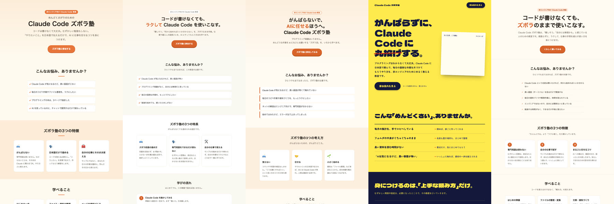

# 「Claude Code に要るのは5つのスキル」本当か、全部入れて試した

Claude Code ズボラ塾のリール（FC13）で「5」とコメントしてくれた方へ。
海外で93万回見られたリールで「要るのはこの5つ」と紹介されていたスキルを、僕が実際に入れて試した結果です。

## ひと目で

| | 名前 | ひとことで | 試した結果 |
|---|---|---|---|
| ① | Find Skills | やりたいことに合うスキルを探す | 「ネットで探してよいか」の許可待ちで止まり、探さずに作った |
| ② | Superpowers | 作る前に相談・計画させる | 見た目は入れる前とほぼ同じ。1回頼むだけだと良さが出ない |
| ③ | Claude Mem | 前の会話を覚えさせる | 入れなかった（裏で動き続ける仕組みが要る） |
| ④ | Impeccable | ページの見た目を良くする | **見た目が変わったのはこれだけ**。時間は約2.4倍 |
| ⑤ | Task Observer | 使うほどスキルを育てる | 見た目はほぼ同じ。記録を残す仕組みが動くことは確かめた |

左から：入れる前／Find Skills／Superpowers／Impeccable／Task Observer

## どう試したか

- 何も入れない部屋と、スキルを1つずつ入れた部屋を用意した（ふだんの仕事とは別のフォルダ）
- どの部屋でも同じお願い「Claude Code ズボラ塾の紹介ページを、HTML 1枚で作って」を1回ずつ
- かかった時間：入れる前 35秒／Find Skills 48秒／Superpowers 35秒／Impeccable 85秒／Task Observer 35秒

## ① Find Skills（ファインド・スキルズ）

- **何をするか**：やりたいことを言うと、合うスキルをネットで探してくれる
- **向く人**：何を入れたらいいか分からず、道具を探したい人
- **向かない人**：使う道具がもう決まっている人
- **気をつける所**：検索の上位でも、安全とは限らない。**別の人が作った、同じ名前のスキル**も出てきた（Superpowers という名前で、作った人が違う物など）。名前だけで選ばず、作った人を確かめる
- **試した結果**：「このページに合うスキルを探して」と頼んだが、探す前に許可待ちで止まり、そのままふつうに作った。見た目は入れる前とほぼ同じ（[できたページ](images/1_find-skills.jpg)）
- **置き場**：[vercel-labs/skills](https://github.com/vercel-labs/skills)

## ② Superpowers（スーパーパワーズ）

- **何をするか**：いきなり作らず、「何を作るか相談 → 手順を決める → 確かめながら進める」をさせる
- **向く人**：少し大きな物を、相談と確認を重ねて作りたい人
- **向かない人**：小さな物をすぐ1回で作りたい人。質問のやり取りが面倒な人
- **気をつける所**：本来は、会話の始まりに自動で動く仕掛けと一緒に入れる。質問が増えるので、1回のお願いで完成するとは限らない
- **試した結果**：見出しの言い回しが少し違うだけで、見た目はほぼ同じ（[できたページ](images/2_superpowers.jpg)）
- **置き場**：[obra/superpowers](https://github.com/obra/superpowers)

## ③ Claude Mem（クロード・メム）

- **何をするか**：作業の記録を自動で残し、別の会話からでも前のことを探せるようにする
- **向く人**：会話を変えると、前に決めたことが分からなくなって困る人
- **向かない人**：今のメモ（CLAUDE.md など）で足りている人。記録がどこに保存され、どこに送られるかを自分で管理したくない人
- **気をつける所**：スキルのファイルを置くだけでは動かない。**裏で動き続けるプログラム・自動の仕掛け・記録の保存場所**が要る。気軽に入れる物ではない
- **試した結果**：上の理由で、今回は入れていない（説明書と中身だけ読んだ）
- **置き場**：[thedotmack/claude-mem](https://github.com/thedotmack/claude-mem)

## ④ Impeccable（インペッカブル）

- **何をするか**：ページの文字・色・配置・使いやすさを考えて、見た目を整える
- **向く人**：作ったページの見た目を、思い切り変えたい人
- **向かない人**：見た目の決まりがもうあって、変えたくない人。早く作りたい人
- **気をつける所**：本式に入れると、足りない部品を外から取ってくる仕組みも一緒に入る。今回は説明書の部分だけで試した（補助の道具は許可が出ず動かなかった）ので、本来の力の一部
- **試した結果**：**黄色い地に太い字で、ほかと全然違うページになった**。時間は 35秒 → 85秒（[できたページ](images/3_impeccable.jpg)）
- **置き場**：[pbakaus/impeccable](https://github.com/pbakaus/impeccable)

## ⑤ Task Observer（タスク・オブザーバー）

- **何をするか**：作業中に言われた直しや、くり返しを記録して、次にスキルを良くする材料にする
- **向く人**：同じ注意を何度もしていて、出てきた改善の案を見直す時間がある人
- **向かない人**：使う回数が少ない人。直しを記録する仕組みがもうある人
- **気をつける所**：使うほど育つ道具なので、1回では差が出ない。フォルダに置くだけで毎回必ず動くわけではない
- **試した結果**：見た目はほぼ同じ（[できたページ](images/4_task-observer.jpg)）。記録を1件残して、別の場所から読み直せることは確かめた
- **置き場**：[rebelytics/one-skill-to-rule-them-all](https://github.com/rebelytics/one-skill-to-rule-them-all)

## 僕の答え

**人気の5つを全部入れる前に、いま一番困っていることを1つ選ぶ。**

- 道具が見つからない → Find Skills
- 作る途中で話がずれる・確かめ忘れる → Superpowers
- 前に決めたことが探せない → まず今のメモを見直す。それでも足りなければ Claude Mem
- ページの見た目を変えたい → Impeccable（今回はっきり差が出たのはこれだけ）
- 同じ注意を何度もしている → Task Observer

入れたら1つずつ、同じお願いで「入れる前」と比べる。「入れた」と「役に立った」は別です。

---
- どれも1回ずつ試した結果です。同じお願いでも、作るたびに見た目は少し変わります
- 入れる前に、それぞれの説明（README）と決まり（LICENSE）を読んでください
- 星の数や検索の順番は、安全の保証ではありません。作った人と置き場を確かめてください

Claude Code ズボラ塾｜ひで（Instagram @claudecode_chefhide）
Claude Code を始めた非エンジニアへ。詰まった所は、直し方ごと見せます。
